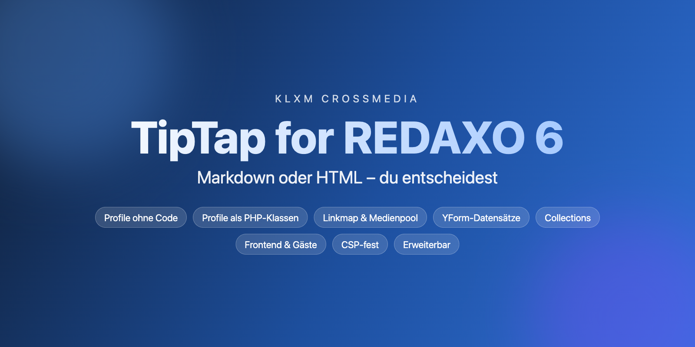
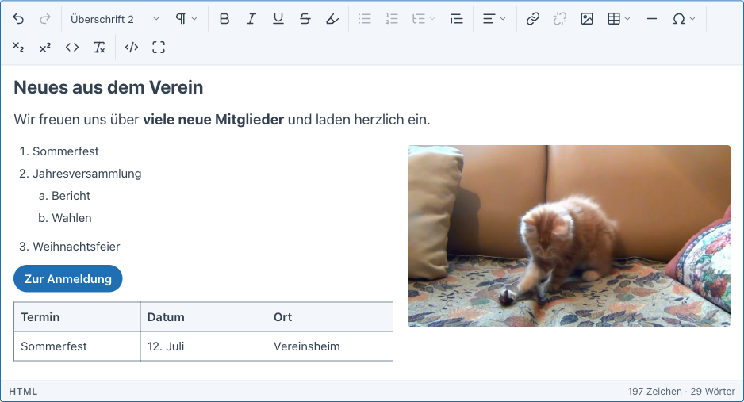
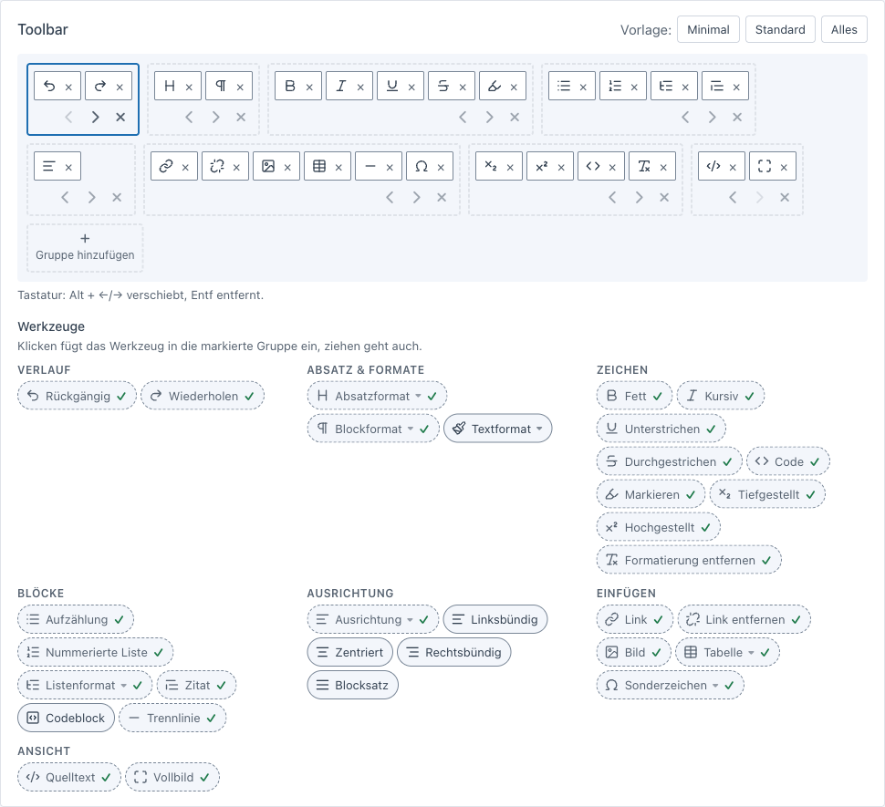
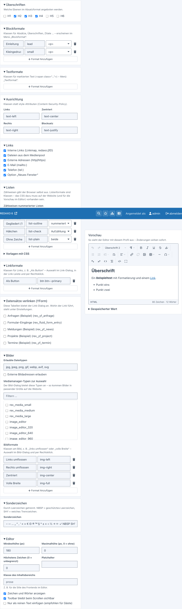
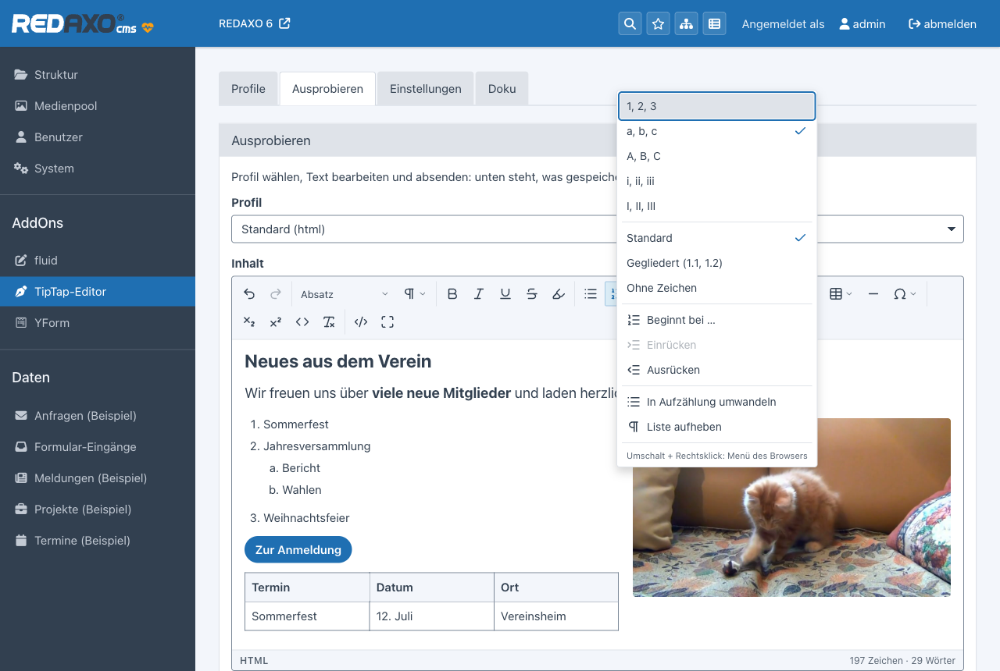
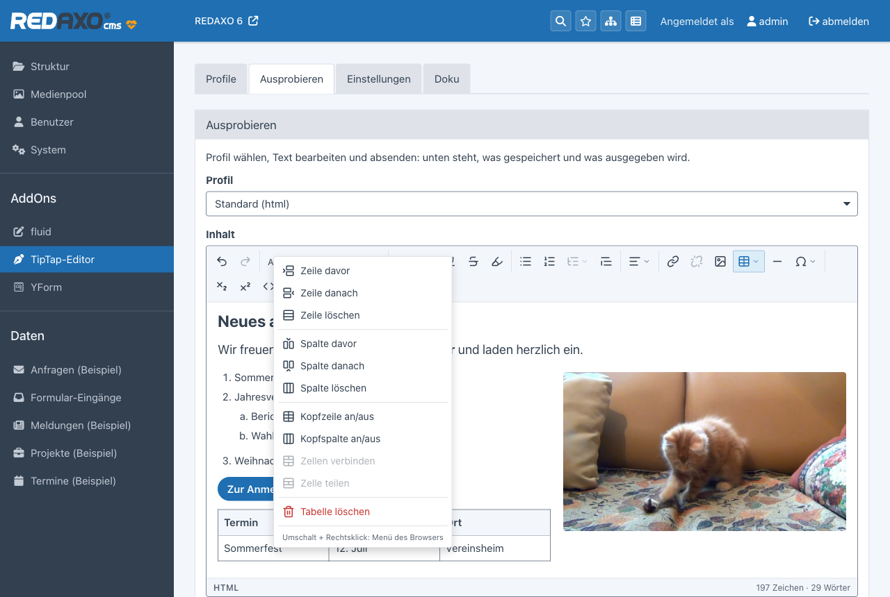
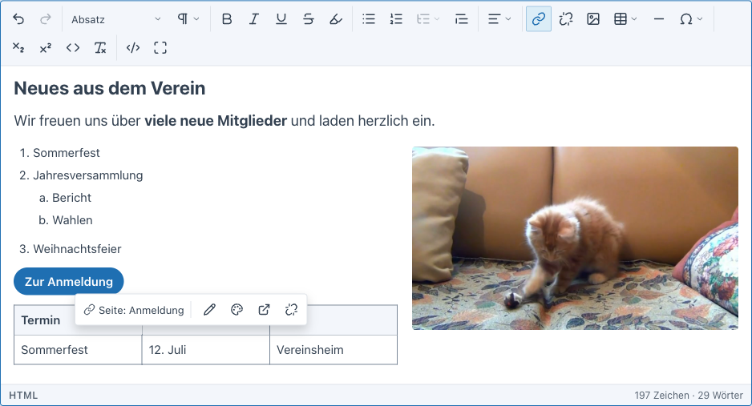
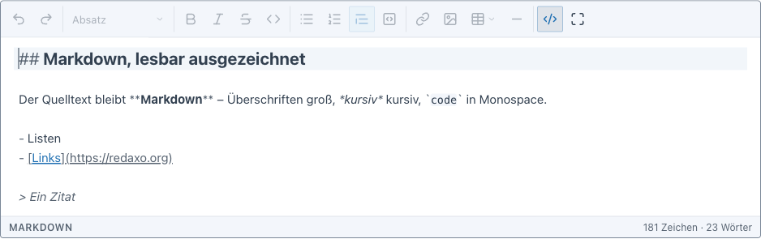
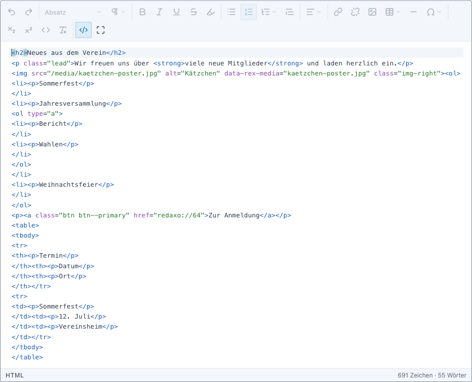
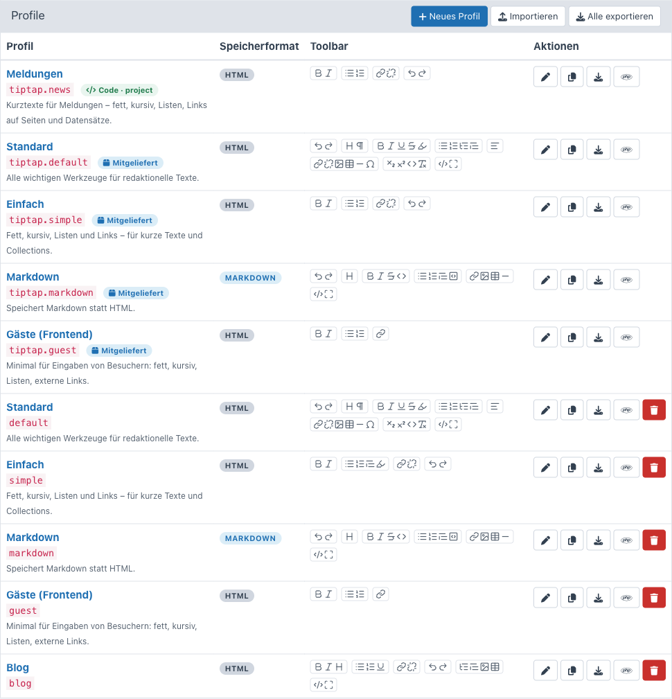

# TipTap for REDAXO 6

WYSIWYG- und Markdown-Editor für REDAXO 6 auf Basis von [TipTap](https://tiptap.dev) (ProseMirror). Er läuft im
Backend, in Collections und im Frontend.
Ein AddOn von [KLXM Crossmedia](https://klxm.de). · [English](README.md)



## Was das AddOn kann

- **Markdown oder HTML** je Profil. Der Quelltext ist ausgezeichnet: Markdown sieht aus wie formatierter Text,
  HTML bekommt Syntax-Hervorhebung.
- **Profile ohne Code:** Ein Builder stellt die Toolbar per Klick oder Drag & Drop in Gruppen zusammen, mit Menüs,
  Symbolen und Live-Vorschau. Import und Export laufen über JSON.
- **Profile als PHP-Klassen** (`#[AsProfile('tiptap.news', …)]`): versioniert mit dem Projekt, ohne Abgleich der
  Datenbank zwischen Stage und Live.
- **REDAXO-Anbindung:**
  - Seiten aus der Linkmap (`redaxo://ID`).
  - Dateien und Bilder aus dem Medienpool, mit Mediamanager-Typ.
  - Links auf YForm-Datensätze.
- **Formate als CSS-Klassen:** Block-, Text-, Link- (z. B. „Als Button“), Bild- und Listenformate sowie die
  Ausrichtung. Es entstehen keine `style`-Attribute, das hält die Content-Security-Policy ein.
- **Videos und Einbettungen:**
  - Lokale Videos aus dem Medienpool mit Vorschaubild, Steuerelementen, Autoplay, Schleife, Medienformaten und
    Seitenverhältnis.
  - YouTube und Vimeo per Adresse (auch einfach einfügen). Gespeichert wird nur die Adresse; auf der Website ein
    2-Klick-Platzhalter mit Vorschaubild vom eigenen Server, vor dem Klick lädt nichts vom Anbieter.
  - HTML-Embeds: geschützter Block für eigenes HTML/JS, den das Bearbeiten nicht zerstört. Freigeben dürfen nur
    Benutzer mit dem Recht „HTML-Embeds“ (Signatur des Servers), Skripte bekommen den Nonce der Antwort, optional
    erst nach Einwilligung.
- **Listen:** Zählweise je Ebene (1, a, A, i, I), Startnummer, gegliedert (1.1, 1.2) per Vorlage.
- **Kontextmenüs** für Tabellen, Listen, Bilder, Links und Überschriften. Dazu kommt eine **Link-Leiste**, die das
  Ziel lesbar anzeigt.
- **Collections und Repeater:** Das Web Component `<rex-tiptap>` startet bei neuen Einträgen von selbst und bleibt
  beim Sortieren erhalten.
- **Frontend und Gäste:** eigenes Bundle, das sich bei Bedarf selbst lädt. Eingaben werden auf dem Server nach dem
  Profil bereinigt.
- **Erweiterbar:** andere AddOns melden Werkzeuge, TipTap-Erweiterungen, Kontextmenü-Einträge, Symbole und Texte
  an.

## Bilder

| Profil-Builder | Einstellungen und Vorschau |
| --- | --- |
|  |  |

| Rechtsklick in eine Liste | Rechtsklick in eine Tabelle |
| --- | --- |
|  |  |

| Link-Leiste | Markdown, ausgezeichnet |
| --- | --- |
|  |  |

| HTML-Quelltext | Profile aus Code, mitgeliefert, Datenbank |
| --- | --- |
|  |  |

## Installation

```bash
composer require klxm/tiptap
php bin/console migrate
```

Mitgeliefert sind die Profile `tiptap.default`, `tiptap.simple`, `tiptap.markdown` und `tiptap.guest`. Sie lassen
sich im Backend anpassen und jederzeit zurücksetzen.

## Kurz

```php
use Klxm\Tiptap\Field\Editor;
use Klxm\Tiptap\Tiptap;

#[Editor('Text', profile: 'tiptap.default')]
public string $text = '';

public function output(): string
{
    return Tiptap::render($this->text, 'tiptap.default');
}
```

- **YForm 6:** `yield \Klxm\Tiptap\YForm\Editor::new('text')->profile('tiptap.simple');`
- **Beliebige Textarea:** `<textarea data-tiptap="tiptap.simple">`
- **Frontend:** `echo Tiptap::editor('nachricht', $value, 'tiptap.guest');` und beim Absenden
  `Tiptap::sanitize(…, 'tiptap.guest')`.

Ein Profil als Klasse im Projekt:

```php
#[AsProfile('tiptap.news', 'Meldungen')]
final class NewsProfile extends ProfileDefinition
{
    public function config(): array
    {
        return ['toolbar' => [['bold', 'italic'], ['bulletList', 'orderedList'], ['link', 'unlink']]];
    }
}
```

## Doku

Die Doku steht im Backend unter **TipTap-Editor → Doku** und in [`docs/`](docs/):

- [Einstieg](docs/01_start.md)
- [Verwendung](docs/02_usage.md)
- [Profile](docs/03_profiles.md)
- [Profile als PHP-Klassen](docs/04_code.md)
- [Für Entwickler](docs/05_developer.md)
- [Sicherheit](docs/06_security.md)

## Entwicklung

```bash
npm install
npm run build   # oder: npm run watch
```

Die Quellen liegen in `resources/js/`. Das Ergebnis in `assets/` wird eingecheckt, damit Composer-Nutzer kein npm
brauchen. CodeMirror für die Quelltext-Ansicht wird erst beim Öffnen nachgeladen (`assets/chunks/`).

## Lizenz

MIT, © KLXM Crossmedia GmbH. Enthält TipTap/ProseMirror (MIT), CodeMirror/Lezer (MIT), marked (MIT), linkifyjs (MIT)
und Lucide-Symbole (ISC).
