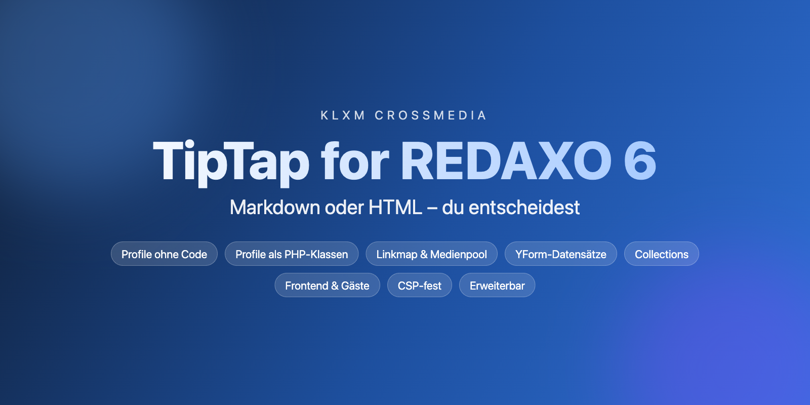
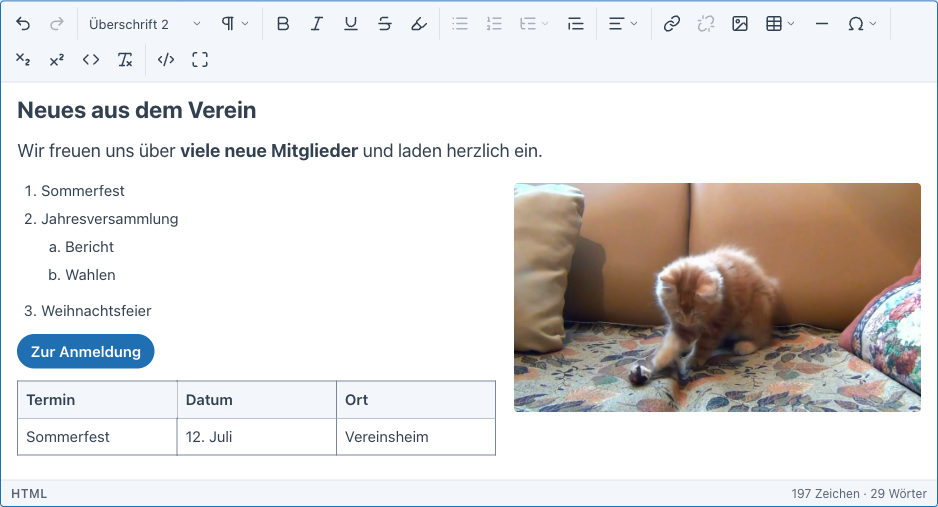
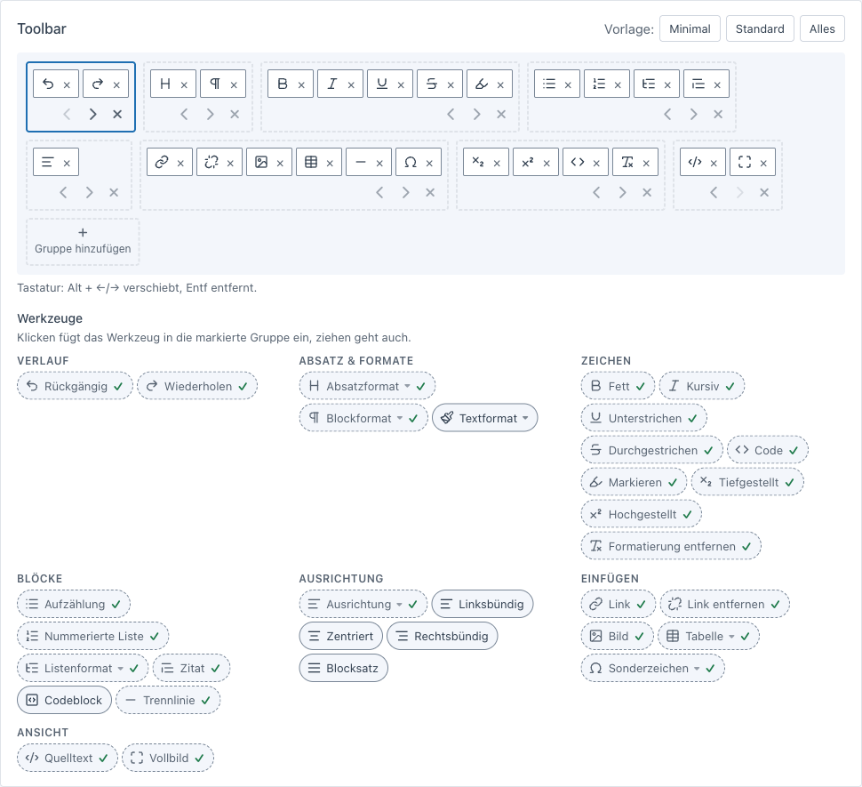
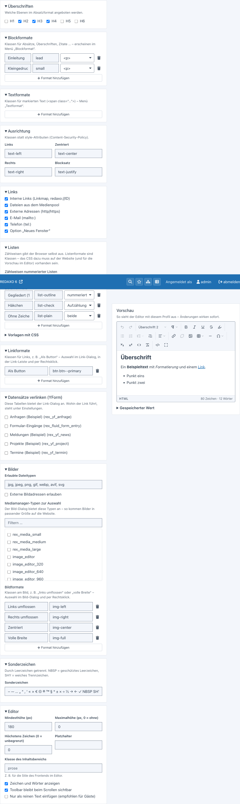
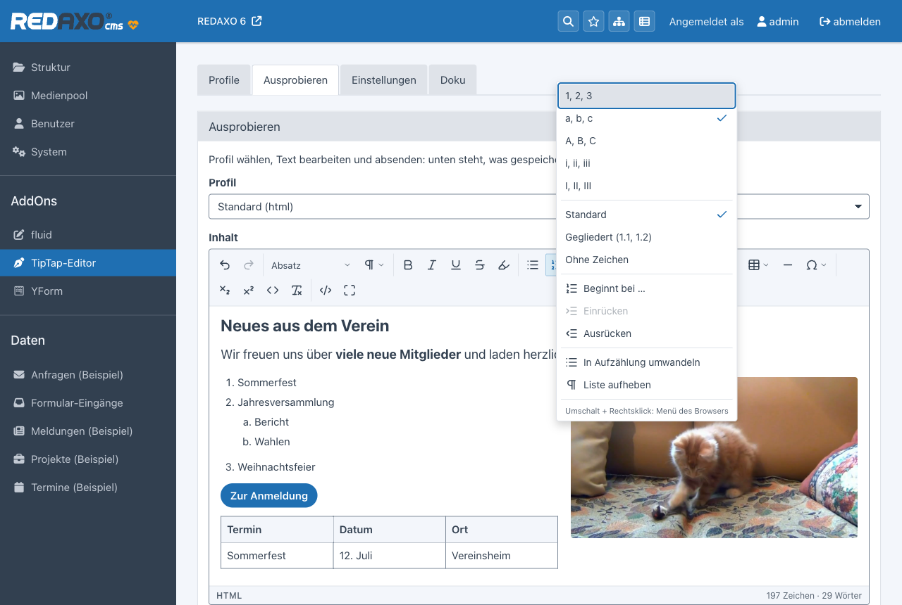
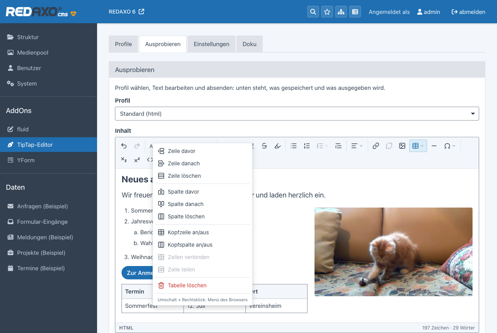
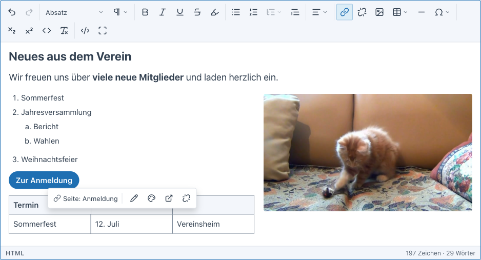
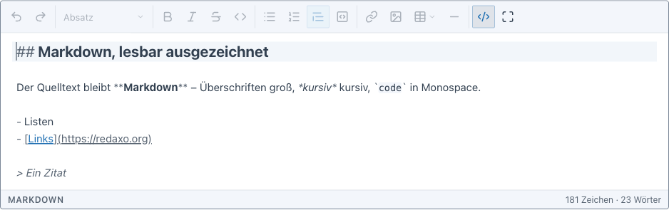

# TipTap for REDAXO 6

WYSIWYG and Markdown editor for REDAXO 6 based on [TipTap](https://tiptap.dev) (ProseMirror). It runs in the
backend, in collections and in the frontend.
An addon by [KLXM Crossmedia](https://klxm.de). · [Deutsch](README.de.md)



## Features

- **Markdown or HTML** per profile. The source view is highlighted: Markdown looks like formatted text, HTML gets
  syntax highlighting.
- **Profiles without code:** a builder arranges the toolbar in groups by click or drag & drop, with menus, icons
  and a live preview. Import and export use JSON.
- **Profiles as PHP classes** (`#[AsProfile('tiptap.news', …)]`): versioned with the project, no database sync
  between stage and live.
- **REDAXO integration:**
  - Pages from the linkmap (`redaxo://ID`).
  - Files and images from the media pool, with media manager types.
  - Links to YForm records.
- **Styles as CSS classes:** block, text, link (e.g. “as button”), image and list styles as well as alignment.
  No `style` attributes, so the Content Security Policy holds.
- **Videos and embeds:**
  - Local videos from the media pool with poster, controls, autoplay, loop, media styles and aspect ratios.
  - YouTube and Vimeo by address (pasting the address works too). Only the address is stored; on the website a
    two-click placeholder with a poster image fetched by the server, nothing loads from the provider before the click.
  - HTML embeds: a protected block for custom HTML/JS that editing cannot break. Only users with the permission
    “HTML embeds” can approve code (server signature), scripts get the nonce of the response, optionally behind
    consent.
- **Lists:** numbering per level (1, a, A, i, I), start number, outline numbering (1.1, 1.2) via preset.
- **Context menus** for tables, lists, images, links and headings, plus a **link bar** showing the target in plain
  words.
- **Collections and repeaters:** the web component `<rex-tiptap>` starts on new items by itself and survives
  reordering.
- **Frontend and guests:** a standalone bundle that loads itself when needed. Input is sanitized on the server per
  profile.
- **Extensible:** other addons register tools, TipTap extensions, context menu entries, icons and texts.

## Screenshots

| Profile builder | Settings and preview |
| --- | --- |
|  |  |

| Right click in a list | Right click in a table |
| --- | --- |
|  |  |

| Link bar | Highlighted Markdown |
| --- | --- |
|  |  |

## Installation

```bash
composer require klxm/tiptap
php bin/console migrate
```

Built-in profiles: `tiptap.default`, `tiptap.simple`, `tiptap.markdown` and `tiptap.guest`. They can be customized
in the backend and reset at any time.

## Quick start

```php
use Klxm\Tiptap\Field\Editor;
use Klxm\Tiptap\Tiptap;

#[Editor('Text', profile: 'tiptap.default')]
public string $text = '';

public function output(): string
{
    return Tiptap::render($this->text, 'tiptap.default');
}
```

- **YForm 6:** `yield \Klxm\Tiptap\YForm\Editor::new('text')->profile('tiptap.simple');`
- **Any textarea:** `<textarea data-tiptap="tiptap.simple">`
- **Frontend:** `echo Tiptap::editor('message', $value, 'tiptap.guest');` and on submit
  `Tiptap::sanitize(…, 'tiptap.guest')`.

The documentation (German) is in the backend under **TipTap editor → Docs** and in [`docs/`](docs/).

## Development

```bash
npm install
npm run build
```

## License

MIT, © KLXM Crossmedia GmbH. Bundles TipTap/ProseMirror (MIT), CodeMirror/Lezer (MIT), marked (MIT), linkifyjs (MIT)
and Lucide icons (ISC).
